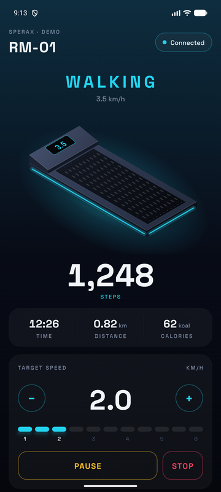
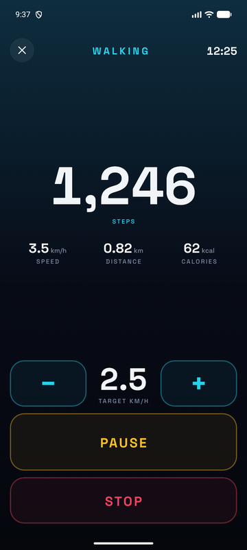
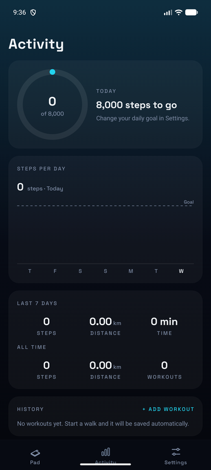
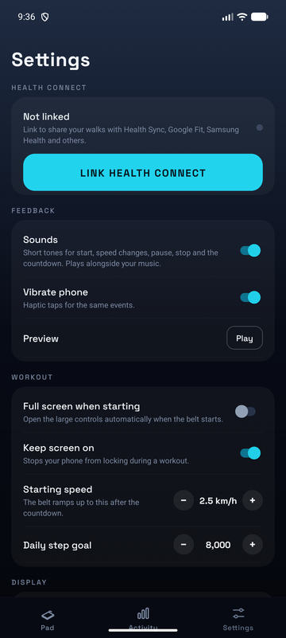

# Sperax Walkpad

**An open-source replacement for the SPX Fitness app, for Sperax walking pads.**

Sperax shut down the servers behind the SPX Fitness app, and owners were locked out of pads they had paid for. Walkpad talks to the pad directly over Bluetooth, so it needs no account, no server and no internet connection.

<p align="center">
  
  
  
  
</p>

> **Not affiliated with Sperax.** The pad protocols were reverse engineered for interoperability, so people can keep using hardware they own. No code from the SPX Fitness app is included here.

## Features

- **Control your pad:** start, pause, resume, stop, set the speed, and use vibration on pads that have it.
- **Live stats:** steps, time, distance, calories and speed, shown on an animated 3D model of your pad.
- **Full-screen workout view:** large buttons that are easy to hit while you walk, with the screen kept on.
- **Workouts saved automatically:** pauses don't split a workout, and a walk is still saved if the app is closed mid-workout.
- **Health Connect sync:** steps, distance, calories and a walking session go to Health Connect, so Health Sync, Google Fit, Samsung Health and others can read them.
- **Activity history:** a daily step goal, a 7-day chart, totals, and walks you can add by hand.
- **Sounds and haptics:** tones for the countdown, speed changes, pause and stop. They mix with your music instead of pausing it.
- **Demo mode:** try the app without a pad.

## Supported pads

| Pad | Status |
|---|---|
| Sperax RM01 walking + vibration pad (Bluetooth name `SPERAX_RM01`) | ✅ Works, tested on a real pad |
| Sperax `SPERAX_RM-01` (hyphenated), P2 MAX, P3 MAX, P3 PRO, F1, L400, L400B | 🧪 Should work, needs testers |
| Other brands' treadmills that support Bluetooth FTMS | 🧪 Should work, needs testers |

**Own one of the 🧪 pads?** Please [report whether it works](../../issues/new?template=pad-report.yml). It takes two minutes, and it's the most useful thing you can do for this project.

## Install

### Download

Prebuilt APKs will be posted on the [Releases](../../releases) page. To install one, download the `.apk` on your Android phone, open it, and allow installing from this source when asked.

### Build from source

You need Node.js 20 or newer, JDK 17 and the Android SDK.

```bash
git clone https://github.com/Guhan-SenSam/sperax-walkpad.git
cd sperax-walkpad
npm install
npx expo prebuild --platform android
npm run build:apk
adb install -r android/app/build/outputs/apk/release/app-release.apk
```

The release build is signed with a debug key, which is fine for sideloading. For a store release, set up your own signing key.

**Requirements:** Android 8.0 or newer with Bluetooth LE. Health Connect is built into Android 14 and newer; on older versions, install it from the Play Store.

## Using it

1. Switch on your pad, and make sure no other phone is connected to it. Pads accept only one connection at a time.
2. Open Walkpad and tap **Connect**. The pad is found automatically.
3. Pick a speed and tap **Start**. The pad counts down 3-2-1, then ramps up to your speed.
4. Tap the expand icon for the full-screen controls.
5. To share your steps, go to **Settings → Link Health Connect**.

### How workouts are recorded

- **Start:** a workout starts when the belt starts.
- **Pausing** never ends a workout.
- **Stopping:** pressing **Stop** in the app saves the workout as soon as the belt stops. If the pad is stopped another way (its remote, for example), the workout is saved after the belt has been stopped for 30 seconds, or when the app disconnects.
- **Closing the app:** the workout in progress is saved every few seconds, so closing the app doesn't lose it.
- **Very short walks:** anything under 15 seconds with no steps is discarded as an accidental start.
- **Health Connect:** each record has a stable ID, so re-syncing never creates duplicates. Deleting a workout in the app does not delete it from Health Connect.

## Development

```bash
npm test          # protocol, FTMS and workout-tracker tests (no device needed)
npx tsc --noEmit  # typecheck
npx expo lint     # lint
```

To work on the UI without a pad, in an emulator for example, turn on **Demo mode** in Settings.

### Project layout

```
src/
  app/            Screens (Expo Router): tabs, full-screen workout, onboarding, add workout
  drivers/        One driver per pad protocol, picked automatically after connecting
  protocol.ts     Sperax UART framing, CRC and status parsing
  tracker.ts      Turns the pad's counters into whole workouts
  health.ts       Health Connect permissions and writes
  AppProvider.tsx Shared state: connection, workouts, settings, feedback
docs/PROTOCOL.md  Byte-level protocol documentation
scripts/          Tests and the sound generator
```

### Adding a pad

1. Implement `PadDriver` (`src/drivers/types.ts`) in a new file in `src/drivers/`.
2. Register it in `pickDriver` in `src/drivers/index.ts`. Drivers are matched on the Bluetooth services the pad exposes.
3. Add tests with packets captured from the real device.

[docs/PROTOCOL.md](docs/PROTOCOL.md) documents the existing protocols and is a good starting point. A Python [bleak](https://github.com/hbldh/bleak) script is the quickest way to capture packets from a pad.

## Contributing

Contributions are welcome, especially compatibility reports and drivers for other pads. See [CONTRIBUTING.md](CONTRIBUTING.md).

## License

[MIT](LICENSE) © Guhan Sensam
